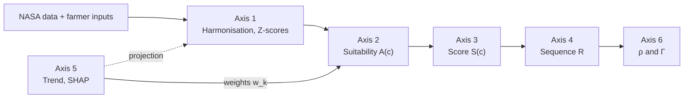

# AgroRot Mathematical Model

**Six transparent and explainable computation axes for crop rotation recommendation**

NASA Space Apps Challenge 2026 — challenge "Changing terrain: adapting farms with NASA data"

Version 1.0 — 14 November 2026

---

## Contents

- [Annotation convention](#annotation-convention)
- [0 Overview and conventions](#0-overview-and-conventions)
- [1 Axis 1 — Spatio-temporal harmonisation and anomaly detection](#1-axis-1--spatio-temporal-harmonisation-and-anomaly-detection)
- [2 Axis 2 — Biological viability of a crop](#2-axis-2--biological-viability-of-a-crop-fuzzy-logic-and-law-of-the-minimum)
- [3 Axis 3 — Trade-off between the farmer's priorities](#3-axis-3--trade-off-between-the-farmers-priorities-multicriteria-decision)
- [4 Axis 4 — Sequential rotation planning](#4-axis-4--sequential-rotation-planning-constrained-combinatorial-optimisation)
- [5 Axis 5 — Climate forecasting and calibration](#5-axis-5--climate-forecasting-and-calibration-statistics-and-interpretable-ml)
- [6 Axis 6 — Quantification of resilience and uncertainty](#6-axis-6--quantification-of-resilience-and-uncertainty-robustness-analysis)
- [7 Parameter summary](#7-parameter-summary)
- [8 Properties to verify by automated tests](#8-properties-to-verify-by-automated-tests)
- [9 Limitations and points of attention](#9-limitations-and-points-of-attention)
- [References](#references)

---

## Annotation convention

Any element that was not explicitly fixed in the project exchanges is flagged in the text by a symbol:

- **†** value, threshold, functional form or method proposed by the authors to complete the formulation (modifiable without changing the structure of the model);
- **‡** element not detailed in the project exchanges (rules R3, R4, R6, R8), to be aligned with the project specification.

Values without annotation are given values. Section 7 summarises all parameters.

---

## 0 Overview and conventions

### 0.1 Purpose of the model

AgroRot is a decision-support tool that proposes to a farmer sequences of crops (rotations) over $N = 6$ seasons, by combining: (i) NASA Earth observations, (ii) local soil characteristics, (iii) a crop catalogue and (iv) the farmer's declared priorities. The model is deliberately free of black boxes: every score breaks down into terms that can be read, checked and explained in plain language to the farmer, the agricultural advisor and the jury.

### 0.2 Computation chain

The six axes are chained as follows (Figure 1):

- **Axis 1** prepares the data;
- **Axis 2** assesses the biological viability of each crop;
- **Axis 3** adds the farmer's priorities;
- **Axis 4** assembles the crops into sequences;
- **Axis 5** provides the climate projection (dashed arrow to Axis 1) and calibrates the Axis 2 weights;
- **Axis 6** audits the result (resilience and confidence).



*Figure 1: Computation chain of the six axes.*

### 0.3 Main notation

| Symbol | Meaning |
|---|---|
| $P$, $S(P)$, $C(P)$ | plot (polygon drawn by the farmer), its area, its centroid |
| $m$, $y$ | month, year |
| $c$, $\mathcal{C}$ | crop, crop catalogue |
| $t$, $N$ | season index, number of seasons in the rotation ($N = 6$) |
| $X_{P,m}$, $Z_{X,m}$ | value of a variable aggregated over the plot in month $m$, its standardised anomaly |
| $f_k$, $w_k$, $A(c)$ | suitability function of factor $k$, its weight, overall suitability of crop $c$ |
| $\pi_j$, $b_j(c)$, $S(c)$ | weight of priority $j$, benefit of $c$ on criterion $j$, seasonal score of $c$ |
| $R = (c_1, \dots, c_N)$ | crop sequence (rotation) |
| $\text{Score}(R)$ | bounded overall score of the rotation, in $[0, 100]$ |
| $\rho(R)$, $\Gamma$ | resilience index, data confidence index |

### 0.4 Status of numerical values

Each numerical value is either **given** (fixed in the project exchanges, no annotation), **proposed†** (a modelling choice added by the authors to complete the formulation, modifiable), or **not detailed‡** (to be defined according to the project specification). Section 7 summarises all parameters.

---

## 1 Axis 1 — Spatio-temporal harmonisation and anomaly detection

### 1.1 Problem statement

NASA products have very different resolutions, whereas the farmer reasons in terms of his field and growing seasons. We must (i) bring all variables onto the plot and onto the season, then (ii) measure how far a situation departs from the historical normal.

### 1.2 Sources and resolutions

*Table 1: Data sources and resolutions (orders of magnitude†).*

| Variable | Source | Spatial resolution | Time step | Series since |
|---|---|---|---|---|
| Temperature, rain, radiation | NASA POWER | 0.5° × 0.625° (≈ 55 × 70 km) | day, month | 1981 |
| Soil moisture | SMAP | ≈ 9 to 36 km depending on product | 2–3 days, month | 2015 |
| Precipitation | GPM IMERG | 0.1° (≈ 10 km) | 30 min, day, month | 2000 |
| Vegetation vigour (NDVI) | MODIS | 250 m to 1 km depending on product | 16 days, month | 2000 |

These values are orders of magnitude, to be confirmed for the exact product used (version, processing level).

### 1.3 Spatial projection

**Data finer than the plot.** For a variable $X$ measured on a grid finer than the plot, we take the integral spatial mean:

$$X_{P,m} = \frac{1}{S(P)} \iint_P X(x, y, m)\, dx\, dy. \tag{1.1}$$

In practice, over pixels $i = 1, \dots, n$ with value $X_{i,m}$, the integral becomes an average weighted by overlap area:

$$X_{P,m} = \frac{\sum_{i=1}^{n} a_i X_{i,m}}{\sum_{i=1}^{n} a_i}, \qquad a_i = S(P \cap \Omega_i), \tag{1.2}$$

where $\Omega_i$ is the footprint of pixel $i$. We also compute a coverage rate $\kappa_P = \sum_i a_i / S(P) \in [0, 1]$: if $\kappa_P < 0.5^\dagger$ (missing pixels, clouds, mask), the variable is flagged as partially observed.

**Data coarser than the plot.** For NASA POWER, the value at the centroid $C(P)$ is extracted by bilinear interpolation between the four neighbouring grid cells:

$$X(C) = (1-u)(1-v)\,X_{00} + u(1-v)\,X_{10} + (1-u)v\,X_{01} + uv\,X_{11}, \tag{1.3}$$

with $u, v \in [0, 1]$ the fractional distances of the centroid within the cell.

**Scale limitation.** When the plot is smaller than a pixel ($P \subset \Omega_i$), equation (1.2) reduces to $X_{P,m} = X_{i,m}$: the value is that of the enclosing cell, not a field measurement. For a smallholding, SMAP (km) and POWER (tens of km) therefore describe the regional context. This limitation justifies the reliability index $q_i = 0.7$ for satellite data (Axis 6) and the invitation to complete them with field measurements.

### 1.4 Temporal aggregation over the crop cycle

Let $M_c(t)$ be the set of months between sowing and harvest of crop $c$ in season $t$ (window fixed by the crop calendar, rule R7 of Axis 4). The cycle-scale variables are defined as:

$$\bar{T}_{P,c} = \frac{1}{|M_c|} \sum_{m \in M_c} T_{P,m}, \qquad P^{\text{cum}}_{P,c} = \sum_{m \in M_c} \text{Rain}_{P,m}, \qquad SM_{P,c} = \frac{1}{|M_c|} \sum_{m \in M_c} SM_{P,m}. \tag{1.4}$$

These three quantities, together with soil pH and texture, feed Axis 2.

### 1.5 Reference climatology

For a variable $X$ and a month $m$, let $Y_X$ be the set of years of the reference period of that variable. The normals are:

$$\mu_{X,m} = \frac{1}{|Y_X|} \sum_{y \in Y_X} X_{P,y,m}, \qquad \sigma_{X,m} = \sqrt{\frac{1}{|Y_X| - 1} \sum_{y \in Y_X} \left(X_{P,y,m} - \mu_{X,m}\right)^2}. \tag{1.5}$$

**Reference period specific to each source.** The 1981–2024 period only applies to NASA POWER. The SMAP archive only starts in 2015 and those of IMERG and MODIS around 2000: the reference period of each variable is therefore that of its own archive, i.e. only about ten years for SMAP. We require $|Y_X| \ge 8^\dagger$; below this, $Z_X$ is not computed and the corresponding adjustment is disabled. With a short series, the robust variant$^\dagger$ $Z^{\text{rob}} = (X - \text{med}) / (1.4826 \cdot \text{MAD})$ can be used.

### 1.6 Z-score normalisation

The standardised anomaly measures, in standard deviations, the distance to the normal:

$$Z_{X,m} = \frac{X_{P,m} - \mu_{X,m}}{\sigma_{X,m}}. \tag{1.6}$$

At the crop-cycle scale, the aggregated version $Z_{X,c} = (X_{P,c} - \mu_{X,c}) / \sigma_{X,c}$ is used, where $\mu_{X,c}$ and $\sigma_{X,c}$ are computed over the same months for the reference years. The sign depends on the variable: a very negative $Z$ is a stress for soil moisture and NDVI; a very positive $Z$ is a stress for temperature.

The stress threshold $-1.5$ is given; the four-level grading is a proposal†. For temperature, the symmetric reading applies with $Z \ge +1.5$ (heat stress).

**Extension for precipitation†.** Rainfall totals have a skewed distribution, for which the Z-score is less reliable. If time permits, it can be replaced by the Standardized Precipitation Index (SPI) [7], which fits a gamma distribution and then standardises; the reading remains the same (negative value = deficit).

*Table 2: Reading of the Z-score (soil moisture, NDVI); four-level grading†.*

| Range of Z | Level | Displayed sentence |
|---|---|---|
| $Z > -1$ | normal | "in line with the normal" |
| $-1.5 < Z \le -1$ | watch | "slightly below the normal" |
| $-2 < Z \le -1.5$ | stress | "clearly below the normal (water stress detected)" |
| $Z \le -2$ | severe stress | "far below the normal (severe water stress)" |

---

## 2 Axis 2 — Biological viability of a crop (fuzzy logic and law of the minimum)

### 2.1 Problem statement

A plant tolerates moderate climate variations but fails abruptly if a single vital parameter (temperature, water, pH) crosses a critical threshold. The model must represent this gradual tolerance and this collapse effect; fuzzy logic [1] provides the framework for the membership functions used below.

### 2.2 Input variables

For a crop $c$ and a given cycle, four factors $k \in \{\text{temp}, \text{water}, \text{pH}, \text{soil}\}$ are evaluated:

- $x_{\text{temp}} = \bar{T}_{P,c}$: mean cycle temperature (°C);
- $x_{\text{water}} = P^{\text{cum}}_{P,c} + I_c$: cumulative rainfall plus declared irrigation $I_c$ (mm);
- $x_{\text{pH}}$: soil pH (entered or estimated);
- $x_{\text{soil}}$: texture/drainage class, converted into an index by the crop's tolerance table (value $f_{\text{soil}} \in [0, 1]$ read directly from the crop table).

### 2.3 Trapezoidal suitability function

For each continuous variable, the optimal range $[b_k, c_k]$ is read from the crop table, then tolerance margins $a_k = b_k - \delta_k$ and $d_k = c_k + \delta_k$ are defined:

$$f_k(x_k) = \begin{cases} 0 & \text{if } x_k \le a_k \text{ or } x_k \ge d_k, \\[4pt] \dfrac{x_k - a_k}{b_k - a_k} & \text{if } a_k < x_k < b_k, \\[8pt] 1 & \text{if } b_k \le x_k \le c_k, \\[4pt] \dfrac{d_k - x_k}{d_k - c_k} & \text{if } c_k < x_k < d_k. \end{cases} \tag{2.1}$$

The margins are $\delta_{\text{temp}} = 5\,°\text{C}$ and $\delta_{\text{water}} = 30\,\%$ of the width of the optimal range, i.e. $\delta_{\text{water}} = 0.30\,(c_{\text{water}} - b_{\text{water}})$. For pH, no margin was set in the project exchanges; we propose $\delta_{\text{pH}} = 0.8$ unit†, to be adjusted crop by crop. A natural source for the ranges $[b_k, c_k]$ is the FAO EcoCrop database† (to be verified before use).

### 2.4 Adjustment for soil moisture (SMAP)

Cumulative rainfall does not tell whether the soil actually stored the water. If the cycle shows a moisture deficit ($Z_{\text{SMAP}} < -1$), the water factor is penalised in proportion to the crop's drought sensitivity $s_c \in [0, 1]$ (column of the crop table):

$$f'_{\text{water}} = f_{\text{water}} \cdot \left(1 - s_c\, \varphi(Z_{\text{SMAP}})\right), \qquad \varphi(Z) = \min\!\left(1, \max\!\left(0, \frac{-1 - Z}{2}\right)\right). \tag{2.2}$$

The penalty is zero at $Z = -1$ and maximal ($= s_c$) for $Z \le -3$. The linear form of $\varphi$ and the bound $-3$ are proposed choices†; the trigger condition $Z_{\text{SMAP}} < -1$ is given. When the adjustment is active, $f'_{\text{water}}$ replaces $f_{\text{water}}$ in equation (2.3).

### 2.5 Overall suitability: weighted geometric mean

$$A(c) = \prod_{k \in \{\text{temp, water, pH, soil}\}} \left(f_k(x_k)\right)^{w_k / W}, \qquad W = \sum_k w_k, \tag{2.3}$$

with initial weights $w = (3, 3, 2, 1)$, i.e. $W = 9$ (Axis 5 may recalibrate them). Convention: $f_k^0 = 1$ for a zero weight, so a zero-weight factor is ignored.

### 2.6 Provable properties

For weights $w_k > 0$, the weighted geometric mean satisfies:

1. $0 \le A(c) \le 1$;
2. $\min_k f_k \le A(c) \le \max_k f_k$ (weighted means inequality);
3. $A(c) = 0 \iff \exists k,\ f_k = 0$: a single zero factor cancels suitability (Liebig's law of the minimum);
4. $A$ is increasing in each $f_k$, and its elasticity is $\dfrac{\partial \ln A}{\partial \ln f_k} = \dfrac{w_k}{W}$: a 10 % increase in $f_k$ raises $A$ by about $10\, w_k / W\ \%$.

**Caveat.** The geometric mean is a strict law of the minimum only when a factor is zero. For low but non-zero values, it is more lenient than a pure minimum (property 2). This is a deliberate choice: it strongly penalises the weakest factor without discarding a crop whose factor is merely mediocre.

### 2.7 Diagnosis: limiting factor and levers

The limiting factor is $k^\star = \arg\min_k f_k$. To quantify the effect of a correction (irrigation, liming, change of date), the potential gain if factor $k$ were raised to 1 is computed:

$$\frac{A(k \to 1)}{A} = f_k^{-w_k / W} \quad \Longrightarrow \quad L_k = f_k^{-w_k / W} - 1. \tag{2.4}$$

### 2.8 Interpretation thresholds†

*Table 3: Suitability interpretation labels (proposed thresholds†).*

| Suitability $A(c)$ | Label |
|---|---|
| $A \ge 0.7$ | well suited |
| $0.4 \le A < 0.7$ | suited with reservations |
| $0.1 \le A < 0.4$ | risky |
| $A < 0.1$ | not recommended |

**Explainability.** Each $f_k$ reads as a percentage of adequacy for a specific parameter, and the weighted product makes it possible to point to exactly which factor blocks or penalises a crop, with the expected gain from a correction.

---

## 3 Axis 3 — Trade-off between the farmer's priorities (multicriteria decision)

### 3.1 Problem statement

Objectives differ from one farmer to another (income, water saving, soil regeneration, fodder). Biological feasibility $A(c)$ must be combined with these preferences, without recommending a crop that is profitable on paper but unsuited to the climate.

### 3.2 Priority weights on the simplex

The $M$ priorities ranked by the farmer are converted into a vector $\pi = (\pi_1, \dots, \pi_M)$ with

$$\pi_j \ge 0, \qquad \sum_{j=1}^{M} \pi_j = 1. \tag{3.1}$$

Since the conversion mode was not fixed in the project exchanges, we propose rank-order centroid (ROC) weights† [6], a standard way to turn a ranking into weights: for the priority of rank $j$,

$$\pi_j = \frac{1}{M} \sum_{i=j}^{M} \frac{1}{i}. \tag{3.2}$$

If the farmer prefers to distribute points, one simply normalises: $\pi_j = p_j / \sum_i p_i$.

### 3.3 Intrinsic crop benefits

For each criterion $j$, crop $c$ has a score $b_j(c) \in [0, 1]$ read from the crop table (for example $b_{\text{nitrogen}} = 1$ for a legume, $b_{\text{water}} = 1$ for a low-demand plant). From a raw quantity $g_j(c)$, the min-max normalisation† is

$$b_j(c) = \frac{g_j(c) - \min_{c'} g_j(c')}{\max_{c'} g_j(c') - \min_{c'} g_j(c')} \ \text{(to maximise)}, \qquad b_j \leftarrow 1 - b_j \ \text{(to minimise)}. \tag{3.3}$$

### 3.4 Seasonal score of a crop

$$S(c) = 100 \cdot A(c) \cdot \left(0.6 + 0.4 \sum_{j=1}^{M} \pi_j\, b_j(c)\right). \tag{3.4}$$

Writing $\lambda = 0.4$ for the share of human choice, the general formula is $S(c) = 100\, A(c) \left[(1 - \lambda) + \lambda \sum_j \pi_j\, b_j(c)\right]$.

**Properties.**

- $0 \le S(c) \le 100\, A(c) \le 100$: suitability is a ceiling. A crop with $A = 0.3$ can never exceed 30, whatever the priorities.
- $S(c) = 0$ if $A(c) = 0$: a biologically impossible crop is never recommended.
- The contribution of priority $j$ to the score is exactly $100\, A(c)\, \lambda\, \pi_j\, b_j(c)$, which allows it to be itemised on screen.

The formula thus separates the physical constraint (60 % tied to $A(c)$) from human choice (40 % driven by $\pi$), and each point of the score is attributable to a factor or a priority.

### 3.5 Ranking robustness (optional†)

Declared priorities are uncertain. To know whether the crop ranking depends strongly on them, we draw $\pi^{(r)} \sim \text{Dirichlet}(\kappa\, \hat{\pi})$ with $\kappa = 20^\dagger$, $r = 1, \dots, n_{\text{draw}}$ with $n_{\text{draw}} = 500^\dagger$, and display for each crop the frequency $\hat{P}(c \text{ ranks first})$ (Algorithm 1). A crop ranking first in more than 80 %† of the draws is a stable recommendation.

**Algorithm 1 — Crop ranking robustness†**

```
Input:  estimated priorities π̂, suitabilities A(c), benefits b_j(c), κ = 20, n_draw = 500
Output: frequency P̂(c ranks first) for each c ∈ C

1: n_c ← 0 for all c ∈ C
2: for r = 1, …, n_draw do
3:     draw π^(r) ~ Dirichlet(κ π̂)
4:     compute S^(r)(c) with π^(r) (equation 3.4) for all c ∈ C
5:     c* ← argmax_c S^(r)(c);  n_c* ← n_c* + 1
6: end for
7: return P̂(c ranks first) = n_c / n_draw for all c ∈ C
```

---

## 4 Axis 4 — Sequential rotation planning (constrained combinatorial optimisation)

### 4.1 Problem statement

A good rotation is not just a stack of the best crops taken in isolation: the order of succession over $N = 6$ seasons determines soil health and disease risk. In addition, Strategy 3 (alternative) must be genuinely different from Strategy 2 (recommended), so as to offer a real choice.

### 4.2 Notation

- $R = (c_1, \dots, c_N)$: the rotation, with the history entered by the farmer $c_0$ (previous crop) and $c_{-1}$;
- $S_t(c)$: Axis 3 seasonal score for crop $c$ in season $t$ (it depends on $t$ because climate and suitability vary from one season to another);
- $\text{Fam}(c)$: botanical family of $c$ (for example Poaceae, Fabaceae, Solanaceae); bare fallow "nu" has no family and has a score $S_t(\text{nu}) = 0$.

### 4.3 Objective function

We look for the sequence that maximises the bounded overall score:

$$\text{Score}(R) = \min\!\left(100, \max\!\left(0,\ \frac{1}{N} \sum_{t=1}^{N} S_t(c_t) + \sum_{t=1}^{N} \text{Bonus}(c_t, c_{t-1}) - \sum_{t=1}^{N} \text{Pen}(c_t, c_{t-1}, c_{t-2})\right)\right). \tag{4.1}$$

The mean $\frac{1}{N}\sum S_t$ is on the $[0, 100]$ scale; bonuses and penalties are points added to or subtracted from the overall score (not divided by $N$): a bonus of $+8$ is worth $+8$ points on the final score.

### 4.4 Formalised agronomic rules

*Table 4: Agronomic rules.*

| Rule | Effect | Formalisation |
|---|---|---|
| R1 | Monoculture penalty $-25$ | $25 \cdot \mathbb{1}[\text{Fam}(c_t) \in \{\text{Fam}(c_{t-1}), \text{Fam}(c_{t-2})\}]$ |
| R2 | Nitrogen bonus $+8$ | $8 \cdot \mathbb{1}[\text{Fam}(c_t) = \text{Fabaceae} \wedge c_{t-1} \in G]$, where $G$ = cereals and nitrogen-demanding crops |
| R5 | Erosion penalty $-10$ | $10 \cdot \mathbb{1}[c_t = \text{nu} \wedge \text{Rainy}(t) = 1]$ |
| R7 | Sowing windows | feasibility constraint: $c \in C_t$ only if its sowing window lies within season $t$ |
| R9 | Exclusions | feasibility constraint: forbidden successions $(c_{t-1}, c_t) \in E$ or crops excluded from the farm |
| R3, R4, R6, R8 ‡ | not detailed | additive bonus/penalty term or feasibility constraint, to be aligned with the project specification |

Season $t$ is a rainy season ($\text{Rainy}(t) = 1$) if the mean GPM IMERG rainfall over the plot in that season exceeds a threshold $\tau_P$ (proposed†: 100 mm/month, to be adjusted locally). Rules R3, R4, R6 and R8 were not detailed in the project exchanges‡; the framework above accepts them as they come, each being either an additive bonus/penalty term or a feasibility constraint.

**Set of feasible crops in season $t$.**

$$C_t = \{c \in \mathcal{C} : \text{R7 satisfied},\ A_t(c) > 0,\ c \text{ not excluded (R9)}\}. \tag{4.2}$$

Penalty and bonus terms at $t = 1, 2$ use the history $c_0, c_{-1}$ supplied by the farmer.

**Consequence of R1 for the catalogue.** With rule R1 as formulated (comparison with the two previous seasons), a simple cereal–legume–cereal alternation is penalised. A penalty-free rotation requires at least three different families in turn. The catalogue must therefore contain crops of varied families (Poaceae, Fabaceae, Solanaceae, Malvaceae, Cucurbitaceae, etc.).

### 4.5 Diversity constraint (Hamming distance)

To guarantee that Strategy 3, $R^{(3)}$, offers a real choice compared with Strategy 2, $R^{(2)}$, we impose [8]

$$d_H\!\left(R^{(2)}, R^{(3)}\right) = \sum_{t=1}^{N} \mathbb{1}\!\left[c^{(2)}_t \ne c^{(3)}_t\right] \ge \left\lceil \frac{N}{2} \right\rceil. \tag{4.3}$$

For $N = 6$, at least 3 seasons must differ. The same procedure can produce a reference Strategy 1 (for example the farmer's current practice, evaluated with the same score for comparison).

### 4.6 Solution by Beam Search

Beam Search [9] with pruning and diversity (width $k = 20$) is given by Algorithm 2.

**Complexity.** Each step examines at most $k\,|\mathcal{C}|$ extensions, i.e. $O(N\, k\, |\mathcal{C}| \log(k |\mathcal{C}|))$ overall.

**Algorithm 2 — Beam Search with pruning and diversity (width k = 20)**

```
Input:  sets C_t (t = 1..N), history (c_-1, c_0), width k,
        reference sequence R(2) (optional), threshold D = ⌈N/2⌉
Output: best sequence R with d_H ≥ D, clipped score in [0, 100] (equation 4.1)

 1: B_0 ← {(empty sequence, cumulative score 0, d = 0)}
 2: for t = 1, …, N do
 3:     Cand ← ∅
 4:     for all partial sequence r ∈ B_{t-1} and crop c ∈ C_t do
 5:         if (c_{t-1}, c) ∈ E then
 6:             skip to next                                  ▷ R9
 7:         end if
 8:         g_t ← S_t(c)/N + Bonus − Pen
 9:         if R(2) is provided then
10:             d ← d + 1[c ≠ c_t^(2)]
11:             if d + (N − t) < D then
12:                 skip to next        ▷ constraint can no longer be satisfied
13:             end if
14:         end if
15:         add the extended sequence to Cand with its cumulative score
16:     end for
17:     merge candidates sharing the same last two crops (c_t, c_{t-1})
        and the same d, keeping the best
18:     B_t ← the k best candidates by cumulative score (lexicographic tie-break)
19: end for
20: return the best sequence of B_N with d ≥ D, then clip to [0, 100] per equation (4.1)
```

**Exact verification (dynamic programming).** Since each term of the objective depends only on $(c_t, c_{t-1}, c_{t-2})$, the best score can be computed exactly by recurrence on the state formed by the last two crops:

$$V_t(a, b) = \max_e \left\{ V_{t-1}(b, e) + g_t(a, b, e) \right\}, \qquad a = c_t,\ b = c_{t-1},\ e = c_{t-2}, \tag{4.4}$$

in $O(N |\mathcal{C}|^3)$ operations. With about thirty crops and $N = 6$, this is of the order of $10^5$ operations. The Hamming constraint is handled exactly by adding $d \in \{0, \dots, N\}$ to the state (Algorithm 3). Dynamic programming thus serves as a regression test for Beam Search: on the real catalogue, both must return the same optimal score (the $[0, 100]$ clipping is monotone and does not change the order of unsaturated sequences).

**Algorithm 3 — Exact dynamic programming (regression test)**

```
Input:  sets C_t, history (c_-1, c_0), increments g_t(a, b, e),
        reference sequence R(2), threshold D
Output: optimal score and associated sequence

1: V_0(c_0, c_-1, 0) ← 0;  V_0 ← −∞ elsewhere
2: for t = 1, …, N do
3:     for all reachable states (b, e, d) and a ∈ C_t such that (b, a) ∉ E do
4:         d' ← d + 1[a ≠ c_t^(2)]
5:         V_t(a, b, d') ← max{ V_t(a, b, d'), V_{t-1}(b, e, d) + g_t(a, b, e) }
6:     end for
7: end for
8: return max_{(a,b), d ≥ D} V_N(a, b, d) and reconstruct the sequence
   by backtracking the maxima
```

### 4.7 Automatic generation of the "Why" section†

Each triggered rule is recorded as (rule, season, points, sentence template). The text of the advice sheet is assembled from these records, for example: *"+8 points in season 2 thanks to cowpea fixing nitrogen after maize"* or *"−25 points in season 4: same botanical family as in season 2 (disease risk and soil exhaustion)"*. Each point gained or lost is thus traced back to a rule and a season; the "Why" section is produced by the engine, not written by hand.

---

## 5 Axis 5 — Climate forecasting and calibration (statistics and interpretable ML)

### 5.1 Problem statement

Climate trends must be anticipated without creating a black box, and the realism of the Axis 2 parameters must be checked against historical data. No deep neural network is used.

### 5.2 Climate projection: monthly normal and linear trend

For a climate variable $Y_{y,m}$ (year $y$, month $m$) from the NASA POWER series (1981–2024), the model is the monthly normal augmented by a trend:

$$\hat{Y}_{y,m} = \bar{Y}_m + \hat{\beta}_m\,(y - y_0), \tag{5.1}$$

estimated by least squares over the training period $Y_{\text{tr}}$ of $n$ years, with $y_0 = \bar{y} = \frac{1}{n}\sum_{y \in Y_{\text{tr}}} y$ (central year):

$$\hat{\beta}_m = \frac{\sum_y (y - \bar{y})(Y_{y,m} - \bar{Y}_m)}{\sum_y (y - \bar{y})^2}, \qquad \bar{Y}_m = \frac{1}{n}\sum_y Y_{y,m}. \tag{5.2}$$

The choice $y_0 = \bar{y}$ guarantees that $\bar{Y}_m$ is exactly the intercept of the model. Rainfall predictions are bounded by $\hat{Y} \ge 0$.

### 5.3 Strict temporal validation

We train on 1981–2018 and test on 2019–2024, never mixing the periods. The mean absolute error over the $n_{\text{te}}$ (year, month) pairs of the test set is

$$\text{MAE}_{\text{trend}} = \frac{1}{n_{\text{te}}} \sum_{(y,m)} \left|Y_{y,m} - \hat{Y}_{y,m}\right|, \qquad \text{MAE}_{\text{clim}} = \frac{1}{n_{\text{te}}} \sum_{(y,m)} \left|Y_{y,m} - \bar{Y}_m\right|. \tag{5.3}$$

The skill score is $SS = 1 - \text{MAE}_{\text{trend}} / \text{MAE}_{\text{clim}}$.

**Decision rule.** If $SS > 0$, the trend is retained; otherwise the system keeps the climatology $\hat{Y}_{y,m} = \bar{Y}_m$ and states this explicitly on the advice sheet (Algorithm 4). A significance condition† may be added: the trend is retained only if $|\hat{\beta}_m| / SE(\hat{\beta}_m) \ge t_{0.975;\,n-2}$, with $SE(\hat{\beta}_m) = s / \sqrt{\sum (y - \bar{y})^2}$ and $s^2 = RSS/(n-2)$.

**A short test window.** Six test years give few points per month; the decision is therefore made over all (year, month) pairs of each variable. For more robustness, this can be complemented by rolling-origin validation† (training on $[1981, Y]$, test on $Y+1$, for several $Y$).

**Algorithm 4 — Choice between trend and climatology**

```
Input:  series Y_{y,m}, training Y_tr = [1981, 2018], test [2019, 2024]
Output: projection Ŷ_{y,m} and indication of the retained model

1: estimate Ȳ_m and β̂_m on Y_tr (equation 5.2)
2: compute MAE_trend, MAE_clim on the test set and SS = 1 − MAE_trend / MAE_clim
3: if SS > 0 then
4:     Ŷ_{y,m} ← Ȳ_m + β̂_m (y − ȳ), bounded to ≥ 0 for rainfall;
       indicate "trend retained"
5: else
6:     Ŷ_{y,m} ← Ȳ_m; indicate "climatology kept"
7: end if
8: return Ŷ_{y,m}
```

### 5.4 Projection uncertainty

For a future year $y$, the 95 % prediction interval of the trend is

$$\hat{Y}_{y,m} \pm t_{0.975;\,n-2}\; s \sqrt{1 + \frac{1}{n} + \frac{(y - \bar{y})^2}{\sum_{y'} (y' - \bar{y})^2}}. \tag{5.4}$$

It widens as one moves away from the training period; its bounds can be used to define stress scenarios for Axis 6.

### 5.5 Calibration of the weights $w_k$ by decision trees and Shapley values

**Data.** An XGBoost [4] or LightGBM [5] model is trained on actual US yields (USDA QuickStats). Each observation is a (county, crop, year) triple for which the explanatory variables are built: mean temperature and cumulative rainfall of the cycle (NASA POWER), soil-moisture anomaly when available, pH and texture (to be joined from a soil database). The target is the yield anomaly, i.e. the yield minus its technological trend per county, so as to measure only the effect of climate and soil.

**Importance by Shapley values [2, 3].** For a model $f$ and a set of factors $F$, the contribution of factor $k$ to the prediction for an observation $x$ is

$$\phi_k(x) = \sum_{S \subseteq F \setminus \{k\}} \frac{|S|!\,(|F| - |S| - 1)!}{|F|!} \left[ f_{S \cup \{k\}}(x) - f_S(x) \right], \tag{5.5}$$

and the global importance is $I_k = \frac{1}{n}\sum_{i=1}^{n} |\phi_k(x_i)|$, normalised as $\tilde{I}_k = I_k / \sum_{k'} I_{k'}$ (exact and fast computation for trees via TreeSHAP).

**Cautious weight update†.** To avoid overfitting and the improper transfer from a US database to another context, the weights are pulled back towards their initial values $w^0$ (retention factor $\eta = 0.5$, proposed†):

$$w_k^{\text{new}} = (1 - \eta)\, w_k^0 + \eta\, W\, \tilde{I}_k, \qquad W = \sum_k w_k^0, \tag{5.6}$$

which preserves $\sum_k w_k^{\text{new}} = W$. The resulting weights are reviewed by an agronomist before adoption (Algorithm 5).

**Good practice.** Grouped cross-validation (for example by State) rather than random, to avoid information leakage between neighbouring counties; results are published together with the model parameters and the SHAP plots.

**Algorithm 5 — Cautious calibration of the viability weights†**

```
Input:  USDA QuickStats yields, NASA POWER/SMAP variables, soil;
        initial weights w⁰ = (3, 3, 2, 1); η = 0.5
Output: weights w_new (reviewed by an agronomist before adoption)

1: build the (county, crop, year) observations and the target
   = yield anomaly per county
2: train XGBoost/LightGBM with grouped cross-validation (by State)
3: compute the Shapley values φ_k (TreeSHAP), then I_k and Ĩ_k
4: w_k_new ← (1 − η) w_k⁰ + η W Ĩ_k  for all k
5: return w_new
```

**Scope of the calibration.** USDA yields describe American agriculture: the calibration validates the order of magnitude of the weights, not their exact value for another region. This is why the initial weights $w = (3, 3, 2, 1)$ and the retention $\eta$ are kept, and why the advice sheet mentions this data origin.

**Explainability.** The linear trend can be read on a simple plot, the fallback rule to climatology guarantees scientific honesty, and Shapley values explain as a percentage how much each factor weighs.

---

## 6 Axis 6 — Quantification of resilience and uncertainty (robustness analysis)

### 6.1 Problem statement

The farmer and his advisor must know (i) whether a rotation will withstand a severe drought and (ii) how much confidence to place in the computations given the quality of the available data.

### 6.2 Climate resilience index $\rho$

The sequence $R$ is evaluated under three stress scenarios: **E1** (rainfall −20 %), **E2** (temperature +2 °C) and **E3** (both simultaneously). Each scenario perturbs the climate inputs of Axis 2 and then reruns the whole chain (suitabilities, scores, rotation):

$$E_1: P^{\text{cum}} \mapsto 0.8\,P^{\text{cum}}; \qquad E_2: \bar{T} \mapsto \bar{T} + 2; \qquad E_3: \text{both}. \tag{6.1}$$

The rainfall perturbation applies to natural rainfall: $x_{\text{water}} = 0.8\,P^{\text{cum}} + I_c$, irrigation being unchanged. By default, the SMAP adjustment term is not modified†. The resilience index is the ratio of the worst case to the nominal score:

$$\rho(R) = \min\!\left(1,\ \frac{\min_{s \in \{E_1, E_2, E_3\}} \text{Score}(R \mid s)}{\text{Score}(R \mid \text{base})}\right) \in [0, 1]. \tag{6.2}$$

The cap at 1 covers the case where a scenario improves the score (for example +2 °C for a crop limited by cold); we assume $\text{Score}(R \mid \text{base}) > 0$.

**Interpretation (proposed thresholds†).**

| $\rho$ | Reading |
|---|---|
| $\rho \ge 0.85$ | robust rotation |
| $0.70 \le \rho < 0.85$ | moderate resilience |
| $\rho < 0.70$ | fragile rotation |

**Locating the fragility.** Let $s^\star$ be the most unfavourable scenario. The most vulnerable season is $t^\star = \arg\max_t \Delta_t$ with $\Delta_t = S_t(c_t \mid \text{base}) - S_t(c_t \mid s^\star)$: the advice sheet then states "season $t^\star$ (crop $c_{t^\star}$) loses the most in case of drought". A mitigation measure (for example supplementary irrigation) can then be tested by changing $I_c$ and recomputing $\rho$. The set of scenarios is extensible (for example −30 % rainfall, +3 °C, or the bounds of the Axis 5 prediction interval). The whole procedure is summarised in Algorithm 6.

**Algorithm 6 — Resilience assessment of a rotation**

```
Input:  rotation R, scenarios {E1, E2, E3}
Output: ρ(R), worst scenario s*, vulnerable season t*

1: compute Score(R | base) and the seasonal scores S_t(c_t | base)
2: for each s ∈ {E1, E2, E3} do
3:     perturb P^cum and/or T̄ (equation 6.1);
       rerun Axes 2 to 4; compute Score(R | s)
4: end for
5: s* ← argmin_s Score(R | s);
   ρ ← min(1, Score(R | s*) / Score(R | base))
6: t* ← argmax_t ( S_t(c_t | base) − S_t(c_t | s*) )
7: return ρ, s*, t*
```

### 6.3 Data confidence index $\Gamma$

Each input variable $v_i$ (pH, texture, rainfall, moisture, previous crop, …) receives a reliability index $q_i$ according to its provenance:

$$q_i = \begin{cases} 1.0 & \text{if confirmed or entered by the farmer}, \\ 0.7 & \text{if derived from a NASA satellite observation}, \\ 0.4 & \text{if default value (not provided)}. \end{cases} \tag{6.3}$$

The overall confidence of the recommendation is the weighted mean

$$\Gamma = \frac{\sum_i \alpha_i q_i}{\sum_i \alpha_i}, \tag{6.4}$$

classified into three levels: **High** ($\Gamma \ge 0.80$), **Medium** ($0.60 \le \Gamma < 0.80$) and **Low** ($\Gamma < 0.60$).

The weightings $\alpha_i$ were not fixed in the project exchanges. We propose† to make them proportional to the influence of the variable on the score, for example by default $\alpha = (2; 1; 3; 2; 2)$ for (pH, texture, rainfall, soil moisture, previous crop), or better $\alpha_i \propto |\partial\,\text{Score} / \partial v_i|$ estimated by finite differences.

**Information gaps and value of a measurement†.** All variables with $q_i = 0.4$ are listed in the "Information gaps" section. To rank them by usefulness, the confidence gain obtained by filling in variable $i$ is computed:

$$\Delta\Gamma_i = \frac{\alpha_i (1 - q_i)}{\sum_{i'} \alpha_{i'}}. \tag{6.5}$$

The advice sheet first proposes the field measurement with the highest $\Delta\Gamma_i$ (for example "test the soil pH").

**What $\Gamma$ measures, and what it does not.** $\Gamma$ summarises the provenance of the data; it is not a probability that the recommendation is correct. The $q_i$ values are project conventions, not measured accuracies.

**Explainability.** Resilience answers "what if the year is dry?" with a number and an identified season, and confidence tells the farmer which field measurement will immediately improve the accuracy of the advice.

---

## 7 Parameter summary

*Table 5: Model parameters; "given" = fixed in the project exchanges; † = proposed; ‡ = not detailed.*

| Parameter | Default value | Status | Where to calibrate / remark |
|---|---|---|---|
| Stress threshold (Z) | −1.5 | given | alert message (Axis 1) |
| SMAP adjustment threshold | $Z < -1$ | given | penalty on $f_{\text{water}}$ (Axis 2) |
| Maximum SMAP penalty bound | $Z = -3$ | proposed† | linear form of $\varphi$ |
| Temperature tolerance margin | $\delta_{\text{temp}} = 5\,°\text{C}$ | given | crop table |
| Water tolerance margin | 30 % of the range | given | crop table |
| pH tolerance margin | $\delta_{\text{pH}} = 0.8$ | proposed† | per crop |
| Viability weights | $w = (3, 3, 2, 1)$ | given | recalibrated by SHAP (Axis 5) |
| Drought sensitivity | $s_c \in [0, 1]$ | given | crop table |
| Rank → weight conversion | ROC | proposed† | or normalised points |
| Share of human choice | $\lambda = 0.4$ (0.6/0.4) | given | Axis 3 |
| Dirichlet concentration | $\kappa = 20$ | proposed† | ranking robustness |
| Number of seasons | $N = 6$ | given | Axis 4 |
| Nitrogen bonus (R2) | +8 | given | Axis 4 |
| Monoculture penalty (R1) | −25 | given | Axis 4 |
| Erosion penalty (R5) | −10 | given | Axis 4 |
| Rainy-season threshold $\tau_P$ | 100 mm/month | proposed† | IMERG, adjust locally |
| Beam width | $k = 20$ | given | Beam Search |
| Diversity threshold | $\lceil N/2 \rceil$ | given | Hamming distance |
| Training / test | 1981–2018 / 2019–2024 | given | Axis 5 |
| Weight retention | $\eta = 0.5$ | proposed† | Axis 5 |
| Stress scenarios | −20 % rain; +2 °C | given | Axis 6 |
| Resilience thresholds | 0.85 / 0.70 | proposed† | Axis 6 |
| Data reliability $q_i$ | 1.0 / 0.7 / 0.4 | given | Axis 6 |
| Confidence thresholds | 0.80 / 0.60 | given | Axis 6 |
| Weightings $\alpha_i$ | (2; 1; 3; 2; 2) | proposed† | or score sensitivity |

**Additional proposed elements not in the original table**

| Parameter | Default value | Status | Where |
|---|---|---|---|
| Minimum coverage rate $\kappa_P$ | 0.5 | † | Axis 1 |
| Minimum series length $\|Y_X\|$ | 8 | † | Axis 1 |
| Grading of Z levels | 4 levels | † | Axis 1 |
| Suitability thresholds | 0.7 / 0.4 / 0.1 | † | Axis 2 |
| Number of draws $n_{\text{draw}}$; stability threshold | 500; 80 % | † | Axis 3 |
| Rules R3, R4, R6, R8 | — | ‡ | not detailed; to be defined (Axis 4) |

---

## 8 Properties to verify by automated tests

To secure the code, these invariants must be tested:

1. $0 \le f_k \le 1$ and $0 \le A(c) \le 1$ for any input; $A(c) = 0$ as soon as some $f_k = 0$.
2. $\min_k f_k \le A(c) \le \max_k f_k$.
3. $0 \le S(c) \le 100\, A(c)$; the priorities $\pi_j$ sum to 1.
4. $\text{Score}(R) \in [0, 100]$ and $\rho \in [0, 1]$ for any sequence.
5. Any returned sequence satisfies R7 and R9, and $d_H(R^{(2)}, R^{(3)}) \ge \lceil N/2 \rceil$.
6. The Beam Search score equals that of exact dynamic programming on the test catalogue.
7. The sum of the displayed contributions (suitability, priorities, bonuses, penalties) exactly reproduces the score.
8. If $SS \le 0$ in Axis 5, the returned projection is the climatology.
9. $\Gamma$ increases (or stays equal) when a variable goes from $q = 0.4$ to $q = 1.0$.

---

## 9 Limitations and points of attention

- **Archives of different lengths.** The Z-score of a variable is computed on the archive of that variable (SMAP since 2015, IMERG and MODIS since 2000, POWER since 1981), not over 1981–2024 for all.
- **Spatial scale.** For a small plot, satellite data describe the surrounding grid cell; the user must be told so and invited to enter local measurements.
- **American calibration.** USDA yields validate orders of magnitude, not values applicable to every region.
- **Short test window** (6 years) in Axis 5: cautious decision and fallback to climatology.
- **Rules R3, R4, R6, R8‡** not detailed in the project exchanges: to be integrated into the Axis 4 framework according to the project specification.
- **Proposed values†.** Parameters marked † complete the formulation; they can be modified without changing the structure of the model.
- **Nature of the model.** AgroRot is an interpretable decision-support tool, not a yield forecasting model: its recommendations must be validated with a local agricultural advisor.

---

## References

1. Zadeh, L. A. (1965). Fuzzy sets. *Information and Control*, 8(3), 338–353.
2. Shapley, L. S. (1953). A value for n-person games. *Contributions to the Theory of Games*, II.
3. Lundberg, S. M. and Lee, S.-I. (2017). A unified approach to interpreting model predictions. *NeurIPS*.
4. Chen, T. and Guestrin, C. (2016). XGBoost: a scalable tree boosting system. *KDD*.
5. Ke, G. et al. (2017). LightGBM: a highly efficient gradient boosting decision tree. *NeurIPS*.
6. Barron, F. H. and Barrett, B. E. (1996). Decision quality using ranked attribute weights. *Management Science*, 42(11).
7. McKee, T. B., Doesken, N. J. and Kleist, J. (1993). The relationship of drought frequency and duration to time scales. *Conference on Applied Climatology*, AMS.
8. Hamming, R. W. (1950). Error detecting and error correcting codes. *Bell System Technical Journal*, 29(2).
9. Lowerre, B. T. (1976). *The HARPY speech recognition system*. PhD thesis, Carnegie Mellon University (origin of Beam Search).
